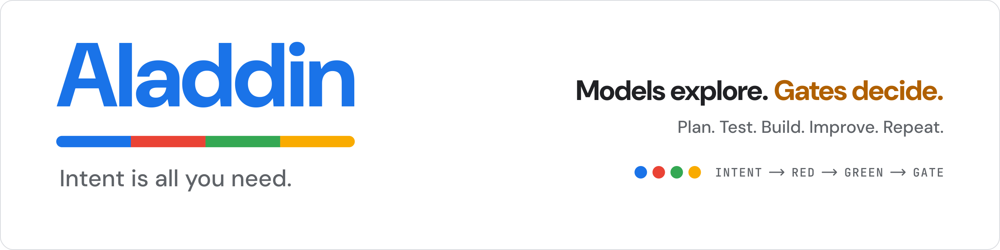
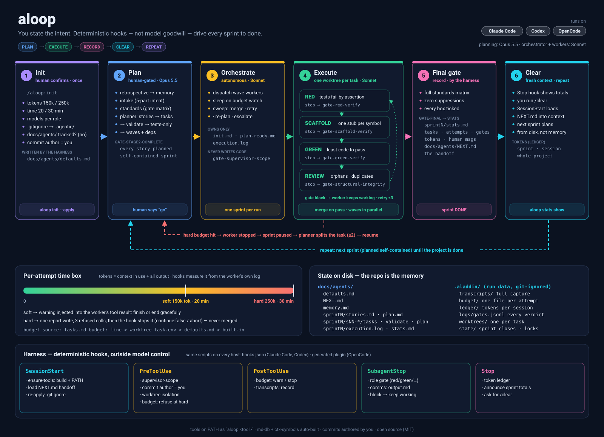
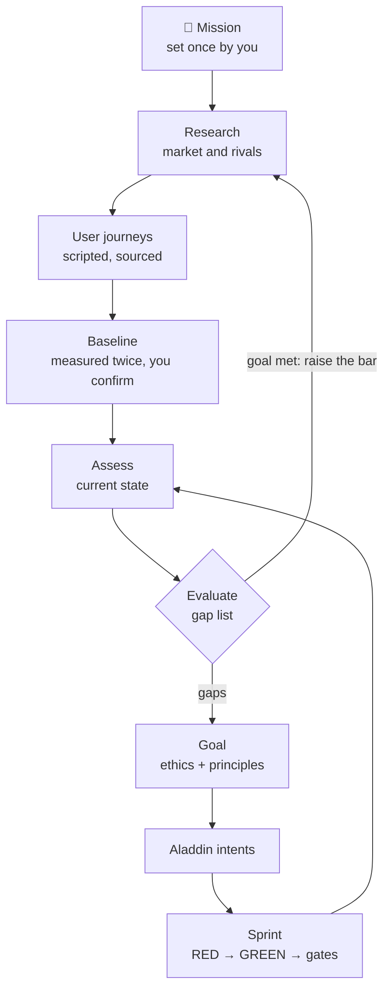

<div align="center">

<picture>
  <source media="(prefers-color-scheme: dark)" srcset="docs/brand/banner-dark.png">
  
</picture>

[](https://github.com/adeelahmad/aloop/actions/workflows/ci.yml)
[](https://github.com/adeelahmad/aloop/releases)
[](LICENSE)
[](#supported-harnesses)
[](https://github.com/adeelahmad/aloop/stargazers)

</div>

# Aladdin: intent is all you need

**aloop** (Aladdin's Loop) turns one line of intent into planned, test-first, gate-verified
code on Claude Code, Codex, OpenCode and DeepSeek Harness. You approve the plan. Cheap workers
build it in isolated git worktrees. Deterministic hooks decide what is accepted, so no model is trusted
to say "done": a gate has to see it.

```console
/plugin marketplace add adeelahmad/aloop          # inside Claude Code
/plugin install aloop@aloop-marketplace
/aladdin add CSV export to the report             # or just ask in your own words
```

About a dollar and ten minutes per tested feature in [measured runs](#demo), on Rust, Python, Go and JS.

<p align="center">
  <a href="#quick-start"><b>Quick start</b></a> ·
  <a href="#how-the-loop-works"><b>How it works</b></a> ·
  <a href="#the-mission-layer"><b>Mission layer</b></a> ·
  <a href="#agent-principles"><b>Principles</b></a> ·
  <a href="#evidence"><b>Evidence</b></a> ·
  <a href="docs/ROADMAP.md"><b>Roadmap</b></a>
</p>

| 🔴 → 🟢 **Test-first by construction** | 🚦 **Models explore. Gates decide.** | 🪙 **Cheap by design** |
|---|---|---|
| Every task starts with a failing test (RED) that a hook proves fails. GREEN is a claim a gate checks, not a sentence a model says. | Deterministic hook gates block a stop or a tool call and hand the reason back. A gate that crashes blocks; a BLOCK is never downgraded. | Workers get their task's contract and tests, never the whole repo, so most of the work runs on the cheapest model. A whole sprint costs about a dollar. |

*Formerly **agentic-agile**; the old names keep working ([upgrading](#upgrading-from-agentic-agile)).*
**New here?** [What this project is](docs/OVERVIEW.md) · [Roadmap](docs/ROADMAP.md) · [Operator playbook](plugin/skills/aloop/SKILL.md) · [The site](https://adeelahmad.github.io/aloop/)

## What's new

- **🧭 The mission layer (M9, in progress).** Set a *mission* ("the world's best to-do app"),
  a budget and a cadence, confirm the baseline once, and walk away. Fixed roles research the
  market, turn user journeys into a reproducible evaluation, derive the next goal from the gap
  list and hand it to Aladdin as intents. Shipped: `aloop mission` init, approval, journeys,
  baseline, research, judges, assess, evaluate, ethics, principles, goals and the Aladdin
  handoff, the six fixed roles with their path-guard gates, the `tick` loop with its cron line,
  the `/aloop:mission` skill and opt-in GA4 telemetry. Next: the end-to-end mission run.
  [More below](#the-mission-layer).
- **🚪 One-way and two-way doors (draft, [#86](https://github.com/adeelahmad/aloop/pull/86)).** Core principles for every agent, inspired by
  Amazon's Leadership Principles: a reversible decision is the agent's to make and record; an
  irreversible one is stopped by a gate until the human authorizes it. [More below](#agent-principles).
- **🐋 A fourth host: DeepSeek Harness.** The same gates and roles, the mission layer's included, on
  the official DeepSeek Harness (`dsh`), next to Claude Code, Codex and OpenCode, tested in CI on
  dsh's real runtime. A measured live run is next (it needs a DeepSeek key).
- **🌐 Any language.** RED is verified on Rust, Python, Go and JS (live runs 21 and 37 to 41), and on
  existing code: runs 42 and 43 extend and change a tested library without touching its seed tests.
- **🔁 Renamed.** agentic-agile is now **aloop** (Aladdin's Loop), on the way to **Aladdin 1.0**.

## Demo

A one-line intent, start to merged code, in a real Claude Code session with the approval given
up front. Reproduce any row with `make e2e-live YES=1 INTENT=<intent>` (about a dollar each;
`HOST=codex` or `HOST=opencode` runs the same loop on those hosts):

| Intent | Result | Time | Cost |
|---|---|---|---|
| a Rust semver parser ([run 21](docs/evidence/README.md)) | 12/12 checks, every dispatch on the project's model | 8m17s | $0.66 |
| a Rust word-frequency tool, two dependent stories ([run 27](docs/evidence/README.md)) | 13/13 checks, 1 supervisor wake | 9m54s | $0.70 |
| a Python slugify package, pytest ([run 37](docs/evidence/README.md)) | 12/12 checks, RED run by the declared pytest | 9m42s | $0.69 |
| a Go Roman-numeral package, `go test` ([run 39](docs/evidence/README.md)) | 12/12 checks | 7m52s | $0.56 |
| a JS camelCase module, `node --test` ([run 41](docs/evidence/README.md)) | 12/12 checks, 1 supervisor wake | 6m45s | $0.56 |
| extend an existing crate, brownfield ([run 42](docs/evidence/README.md)) | 13/13 checks, the seed's tests untouched and green | 7m11s | $0.67 |
| change an existing, tested function ([run 43](docs/evidence/README.md)) | 13/13 checks, 3 lines in `parse`, signature kept | 9m10s | $0.67 |
| a wc-like CLI app, tested by running it ([run 46](docs/evidence/README.md)) | 13/13 checks, 3 tasks, the merged binary works | 15m19s | $0.99 |

Every time and cost in the table above is a row in [docs/evidence/README.md](docs/evidence/README.md), with the
command that reproduces it; what each run found and fixed is logged in
[ROADMAP §0](docs/ROADMAP.md#0-at-a-glance) (M0.8 for runs 1–35, M8 from run 36). The numbers come from the harness
(`run-summary` reads the session's own `result` lines), not from the model.

## Test-driven agents

Do not merely give an agent a goal. Give it a **failing proof of what is missing**, then make it
earn GREEN. Each task runs as a chain of sub-agents, each stopped by a hook that can block the
stop and hand the reason back:

| Step | What the agent does | What the gate checks |
|---|---|---|
| 🔴 **RED** | writes the tests the plan named | they fail by assertion, and no production code changed (`gate-red-verify`) |
| 🟡 **SCAFFOLD** | declares the symbols the tests need | each exists exactly once, as a `SUB-AGENT-TODO` panic stub (`gate-scaffold-verify`) |
| 🟢 **GREEN** | makes the tests pass | inside the task's files only, with zero suppressions (`gate-green-verify`) |
| 🔍 **STRUCTURAL-REVIEW** | looks for duplicates and orphans | symbol uniqueness from `ctx-symbols` |
| ✅ **FINAL-GATE** | runs the sprint's whole matrix once | every planned test is on main |

## How the loop works

<div align="center">
  
  <br><sub>Generated by <code>docs/diagrams/gen_workflow.py</code> · older architecture view: <a href="docs/diagrams/architecture.png">architecture.png</a></sub>
</div>

1. **Intent → contract.** `intake` turns your words into an internal Intent Contract
   (success *and* failure scenarios, open questions classed assume / default / ask / spike).
2. **Planning, with you.** `standards` then `planner` produce the sprint contract and, per story,
   `tasks.md` / `validate.md` / `plan.md`, or a single semantic plan (`targets.json`) they are
   rendered from. The supervisor **stops for your approval**; nothing is built before Stage 2 is approved.
3. **Execution, without you.** One worktree-isolated worker per task through the chain above;
   the supervisor spends no tokens watching (`sweep wait` wakes on events) and acts on facts:
   accept, retry, re-plan, roll over, spawn.
4. **Budgets that plan.** Every attempt is boxed in tokens and minutes (soft warning, hard stop);
   a hard breach is classified and re-planned, never retried as-is; the sprint has its own envelope
   and admission control.
5. **Close and rotate.** The harness writes `stats.md` and a canonical `handoff.json` → `NEXT.md`;
   the next session resumes from evidence (`aladdin resume`), on the same host or another one (`host swap`).

## Why failing first matters

A passing test written after the code proves the code does what the code does. A failing test
written before it proves the code is *missing*, and GREEN is then a claim the gate can check,
not a sentence the model can say. It also keeps workers small: each one gets its task's contract,
its tests and the resolved change targets (`targets context`), never the whole repo.

## Models explore. Gates decide.

Determinism is structural, not vibes. Hooks enforce what the model cannot talk its way past:

- the supervisor cannot write production source (`gate-supervisor-scope`), commit on main during a
  sprint, or dispatch with its backends missing (`gate-tooling`), on a model the project did not
  pick, or before the human approved the sprint's plan, or granted it autonomy, in a line they typed
  (`gate-dispatch`);
- a worker cannot leave its worktree, touch files outside its task, or pass a stop whose gate failed;
- a gate that crashes **blocks** (`_failclosed.sh`), never a silent pass, and never a false block when a
  backend is absent (it degrades to a flagged, weaker check);
- a host that cannot block natively is wrapped by an outer controller (`host check` fails CI otherwise).
  A BLOCK is never downgraded to WARN.

Models pick the route (`strongest | strong | economical`, resolved per host); the gates decide what lands.

## The mission layer

*Missionary Aladdin Genie: milestone M9, in progress. The spec and task graph are in
[ROADMAP §4.12](docs/ROADMAP.md#412-mission-layer-missionary-aladdin-genie-m9); the track notes in
[plugin/mission/README.md](plugin/mission/README.md).*

Aladdin builds what you ask for. The mission layer decides what to ask for next. You set a
**mission**, which is bigger than a goal, plus a budget, a cadence and a mode (autonomous or
spoon-fed). You confirm the starting baseline and the direction in plain language, once. You never
write a metric or a journey. The loop is IBM's autonomic MAPE-K cycle over a committed knowledge
base (`docs/agents/mission/`):



Every element has a deterministic check (`aloop mission <area> check`: exit 0 pass, 2 block,
3 needs the human). The mission is sealed by its sha256 and counts only under the human's own
approval of that exact content: `aloop mission approve` records only when a prompt the human typed
(captured by the `UserPromptSubmit` hook) has a line such as `approve msn_… 3f2a9c1b`, whose code is the
first 8 hex of the content's sha256, so an agent cannot approve its own change (M9.17). The records the
gates decide from (approvals, measurements, assessments, retirements, goals) are rows in a
hash-chained, committed ledger, so an edited or backdated row, or one removed before the newest,
fails the check. The ethics verdicts, the `tick --force` grant and `mission.budget_exhausted` are
still run-log events, and a removed newest row is caught only where the run log survives (M9.24). The confirmed definition of "best" is the
mission's RED: a baseline whose journeys all pass already is refused. Usage telemetry (GA4,
opt-in) informs goals and is never a gate.

| Track | What | Status |
|---|---|---|
| Core | `aloop mission init / approve / check / status`, the sealed mission, the ledger | ✅ shipped |
| Journeys, baseline, assess, evaluate | user journeys as the evaluation, a frozen baseline, the gap list | ✅ shipped |
| Research and judges | sourced claims with archived snapshots; LLM judges on pinned models and a frozen rubric, decided by majority | ✅ shipped |
| Ethics and principles | clear / gray / hard-line review of every goal, consent bound to its sha256; the principles below | ✅ shipped |
| Telemetry | GA4 set up by the agents through its API, opt-in, minimum-sample rule | ✅ shipped |
| Roles and gates | the six fixed roles, their model routes, and two gates (role path guards, artifact checks) | ✅ shipped |
| Goals → intents | the top gaps become a goal, one Intent Contract per gap, handed to Aladdin | ✅ shipped |
| Loop and skill | `tick`, a zero-token `due`, the cron line, budget caps, `/aloop:mission` | ✅ shipped |
| End to end | an offline scripted mission cycle in CI, then a live one | ⏳ next |

## Agent principles

*The goal principles shipped in M9.7 ([plugin/mission/principles.md](plugin/mission/principles.md),
ROADMAP §4.12): every goal carries their hashed block (`aloop mission principles show / hash / check`).
Today the door rule holds at intake: `intent check` (run by `gate-intake`) blocks a run while an `ask`
question, one that is irreversible, security-sensitive or intent-changing, has no recorded answer
(ROADMAP §4.1). A gate for doors met mid-run is in a draft PR,
[#86](https://github.com/adeelahmad/aloop/pull/86).*

Agents that drive goals follow a short set of principles inspired by Amazon's Leadership
Principles, chosen because they pull against each other and so keep the flywheel turning.
No principle can relax an invariant.

> **🚪 Is the door one-way or two-way?**
> A **two-way door** is reversible: a branch, a draft PR, a file, a retry, a re-plan. The agent
> decides, records the call with a one-line reason, and keeps going.
> A **one-way door** cannot be walked back by the time anyone reads about it: a production change,
> a deletion, a message sent outside the project, a weakened gate or test. The agent asks the human
> once, with a recommended option, and the action waits for the human's recorded yes.

| Principle | In practice |
|---|---|
| The autonomic loop | monitor, analyze, plan, execute, then measure again |
| Own the outcome | "done" is the user's goal, not the current step |
| Verify, don't assume | done is a passing gate verdict, never a sentence |
| Ship small, ship often | one task, one RED proof, one worktree |
| Raise the bar | a met goal sends the loop back to the mission for a higher one |
| Disagree, then commit | a decision record with a reason and evidence |
| Leave it better | log it, don't fix it, outside the task's scope |
| Know when to stop and ask | the clarification table: assume, default, ask or spike |
| Grow adoption | real use (journeys completed, users coming back), never engagement tricks |
| Keep it simple | the simplest change that closes the gap: fewest moving parts and tokens, no new service or dependency without a measured need |

Tension pairs: customer obsession vs frugality, bias for action vs dive deep, think big vs
deliver results, grow adoption vs keep it simple.

## Install / run

### Quick start

```bash
# 1) Have a Rust toolchain >= 1.85 (rustup.rs or `brew install rust`). The plugin
#    builds its gate backends (ctx-symbols + md-db) itself on first session start and
#    puts them on PATH for every agent. (Manual alternative: ./plugin/tools/install.sh)

# 2) Add the marketplace and install the plugin (inside Claude Code)
/plugin marketplace add adeelahmad/aloop
/plugin install aloop@aloop-marketplace
/reload-plugins   # apply hooks without a full restart
#    (for local dev, point marketplace add at your checkout instead: ./path/to/repo)

# 3) Say what you want
/aladdin add CSV export to the report
```

**Codex:** from a clone, `plugin/bin/aloop install codex` (agent TOMLs and `aloop` on PATH), then
`codex plugin marketplace add adeelahmad/aloop`, `codex plugin add aloop@aloop-marketplace`, and trust
the hooks once in Codex's `/hooks`. **OpenCode:** `plugin/bin/aloop install opencode` renders
everything. **DeepSeek Harness:** `plugin/bin/aloop install dsh --project .` renders a `dsh` profile,
then run `dsh --profile aloop`. Every way you get full parity (hooks, agents, gates, time box, ledger,
stats, handoff). See [`plugin/README.md` → Codex and OpenCode](plugin/README.md#codex-and-opencode)
and [→ DeepSeek Harness](plugin/README.md#deepseek-harness-dsh).

> **Staying current:** third-party marketplaces don't auto-update by default. Run
> `/plugin marketplace update aloop-marketplace` (or enable auto-update in
> `/plugin` → Marketplaces), then `/reload-plugins`. Step 1 (the Rust-built
> `ctx-symbols` and `md-db`) is what makes the gates run at full strength; without it they
> degrade to grep.

### Run it

- **Just ask** inside the host: the skill is model-invoked and triggers on build / fix /
  improve / add requests even if you never say "agile", or invoke `/aladdin`, `/aloop` or `/aloop:init`.
- **From a shell:** `aladdin "<intent>"` records the intent (on PATH inside host sessions; in your
  own terminal after `aloop install codex|opencode|dsh` links it into `~/.local/bin`, or from a clone as
  `plugin/bin/aladdin`); `aladdin status` (one line per task from
  the harness files, tasks to re-gate, token totals); `aladdin resume` (what the next session
  loads); `aladdin report` (the sprint's `stats.md`); `aladdin target | context | refs | callers`
  (the semantic queries). Every tool is also `aloop <tool>` (`aloop --list`).
- **Settings** live in `.aladdin/config.yaml` (budgets, models, context, semantic, provenance, git);
  `aloop config migrate` creates it from an older `docs/agents/defaults.md`, which is then rendered from it.

### Upgrading from agentic-agile

The plugin is now `aloop@aloop-marketplace` (since v0.11.0; current v0.12.0). Swap the install once:

```bash
/plugin uninstall agentic-agile@agentic-agile-marketplace
/plugin marketplace remove agentic-agile-marketplace
/plugin marketplace add adeelahmad/aloop
/plugin install aloop@aloop-marketplace
```

Nothing in your project changes: `.agentic/`, `docs/agents/` and the `AGENTIC_*` keys in
`defaults.md` are read as before. The old command names `agentic`, `agentic init` and
`agentic-init` still work as aliases of `aloop`. On Codex or OpenCode, re-run
`aloop install <host>`; it removes the pre-rename generated files.

## Supported harnesses

| Host | Install | Gates | Isolation | Status |
|---|---|---|---|---|
| **Claude Code** | `/plugin install aloop@aloop-marketplace` | native hooks | host worktrees (`isolation: "worktree"`) | ✅ reference host, every measured run |
| **Codex** | `aloop install codex` + `codex plugin add aloop@aloop-marketplace` (trust in `/hooks`) | native hooks | `task-worktree` + `aloop bind` | ✅ hooks emulated in CI; live run pending |
| **OpenCode** | `aloop install opencode` | outer (the plugin wraps every tool call) | `task-worktree` + `aloop bind` | ✅ plugin end to end in CI; live run pending |
| **DeepSeek Harness** (`dsh`) | `aloop install dsh`, then `dsh --profile aloop` | native (a plugin on dsh's own deny, block and steer points) | `task-worktree` + `aloop bind` (denial) | ✅ plugin end to end in CI, also on the real dsh runtime; live run pending (needs a DeepSeek key) |

One `HostAdapter` interface behind every host (`aloop host describe`); the same conformance suite
runs on each (`make test-hosts`), and a sprint can move between them from portable state.

## Evidence

**TheNoteBook**, a full Go backend, was built with this plugin (v0.8, June 2026, then named
agentic-agile) from a `README` + `/agentic-agile:init` (today `/aloop:init`) + a handful of prompts. Measured by the owner
from the Claude Code transcript and the resulting repo; it predates the evidence ledger, so it
has no ledger row:

| Metric | Value |
|--------|-------|
| **Output tokens** | **~1.55M** total |
| **Model mix** (by output) | **76% Sonnet 4.6 · 24% Opus 4.8** |
| Agent turns | ~1,140 |
| Input cache hits | **99.9%**: 135M cache-read vs 0.11M fresh read |
| **Produced** | 18 internal packages · ~6.1K LOC production Go + ~11.3K LOC tests · **322 tests** · 74 commits across 6 sprints |

That's a fully-tested ~17K-LOC backend for **~1.5M output tokens**. The leanness is
structural, not luck:

- **Scoped context per worker.** Each sub-agent runs in its own git worktree carrying
  only its task's contract (`init.md`) and the tests, never the whole repo, so cheaper
  models (Sonnet did 76% of the work) handle most tasks.
- **Gates verify deterministically.** `validate_comms`, `ctx-symbols`, `md-db`, and the
  RED/GREEN/structural checks replace expensive model reasoning and re-reads.
- **Caching covers ~99.9% of input**, and the hooks keep the orchestrator cheap by
  blocking it from doing the context-heavy work itself.

Live runs: `make smoke-live YES=1` (hook wiring, ~$0.004) and `make e2e-live YES=1` (the whole
loop, ~$1; each run writes `summary.json` and a row for [docs/evidence/](docs/evidence/README.md)). Offline: `make ci`, which runs Rust fmt/clippy/tests, shellcheck, 54 Python/Node suites plus every `mission-*.test.py`,
the gate conformance fixtures (`make conformance`) and eval-suite validation. Every ROADMAP
requirement is tracked with its test in [docs/TRACKING.md](docs/TRACKING.md).

## Audit

Every run leaves an `aladdin.event/1` stream (`.aladdin/logs/events.jsonl`): intent received,
plan approved, task dispatched, gate verdicts, worktrees merged, commits created, decisions with
their one-line rationale and authority, and never a transcript copy.

```
aloop events trace <sha>        # commit → task → gates → plan → intent → approver
aloop events lineage <task>     # dispatch → attempts → gates → merge
aloop events graph --format dot # the whole run as a graph
aloop stats show                # tokens by class, every session of the project
```

Usage is reported by class (fresh input, cache read/write, output, context) and marked
`estimated` where a host does not report it. Commit messages are built from the task and its
change rationale.

## Architecture

```
.claude-plugin/marketplace.json   marketplace catalog (source: ./plugin)
plugin/                           the installable plugin (see plugin/README.md)
  bin/        the tools and gates (aladdin, aloop, gate-*, budget, sweep, targets, events, host, mission …)
  agents/     the 15 roles (Aladdin's 9 + the mission layer's 6) · skills/ the supervisor playbooks (aloop, aladdin, init, mission)
  hooks/      hooks.json (aloop:<role> matchers) · hosts/ capabilities, routes, the OpenCode and dsh plugins
  mission/    the mission layer's areas (journeys, baseline, assess, evaluate …) and their schemas
  schemas/    KDL schemas for the planning artifacts · tools/ ctx-symbols + md-db sources
docs/                             OVERVIEW.md ROADMAP.md TRACKING.md, the evidence ledger, brand/
```

<details>
<summary><b>Prerequisites</b></summary>

| Tool | Required? | Purpose | Install |
|------|-----------|---------|---------|
| **ctx-symbols** | recommended | symbol uniqueness (`count==1`) + duplicate/orphan detection | `./plugin/tools/install.sh` (builds from `plugin/tools/ctx-symbols`) |
| **md-db** | recommended | validates `.md` artifacts against `plugin/schemas/*.kdl` | `./plugin/tools/install.sh` (builds from vendored `plugin/tools/md-db`, AGPL-3.0) |
| **Rust toolchain** | required to install | builds both backends; also runs the target repo's fmt/clippy/test/coverage matrix | rustup (>= 1.85) |

Both backends are optional: absent → gates WARN and fall back to grep (never a false
block, never a silent pass). See [`plugin/README.md`](plugin/README.md) for the gate
env-contract and how to retarget a non-Rust repo.

</details>

<details>
<summary><b>Development (Makefile)</b></summary>

`make` (no target) prints all targets. Common ones:

```bash
make install        # build + install ctx-symbols and md-db to ~/.local/bin
make link           # register THIS repo as a local marketplace and install the plugin
make ci             # CI's offline checks: fmt-check · lint · test · eval-validate · test-hosts · conformance
make test           # ctx-symbols + md-db unit tests
make lint           # clippy -D warnings + shellcheck + JSON sanity
make validate       # claude plugin validate ./plugin --strict
make eval-validate  # validate every eval suite's JSON (no tokens)
make eval SUITE=…   # run one eval suite live (YES=1 spends tokens; see scripts/eval/)
make hooks          # install the tracked git hooks (.githooks → core.hooksPath)
make smoke          # offline gate smoke test
make release        # verify (ci+validate+version-check) then tag vX.Y.Z
make publish        # push branch + tags to origin
make package        # bundle the release into package/ + publish the GitHub release (gh)
```

Git hooks (opt in with `make hooks`): **pre-commit** runs `fmt-check · json ·
eval-validate · version-check` (fast, no tokens); **pre-push** runs the full
`make ci` (`fmt-check · lint · test · eval-validate · test-hosts · conformance`). Bypass with `SKIP_HOOKS=1`
(e.g. `SKIP_HOOKS=1 git commit …`) for an intentional WIP commit or a known-failing
local dependency.

</details>

<details>
<summary><b>Versioning, changelog and CI</b></summary>

[SemVer](https://semver.org); see [`CHANGELOG.md`](CHANGELOG.md). Keep the version in
`plugin/.claude-plugin/plugin.json`, `plugin/tools/ctx-symbols/Cargo.toml`, and the
top `CHANGELOG.md` entry in lockstep; `make version-check` (and `make release`)
enforce this. Tag releases `vMAJOR.MINOR.PATCH`.

`.github/workflows/ci.yml` runs on every push/PR:

- **rust**: `cargo fmt --check`, `cargo clippy -D warnings`, tests for `ctx-symbols` + `md-db`.
- **shellcheck**: lints every gate script (`plugin/bin/*`), errors fail the build.
- **hosts**: byte-compiles the Python hooks, then Codex hooks emulation + the OpenCode
  and dsh plugins end-to-end, the dsh one also on the real (pinned) dsh runtime against a
  scripted model (no network, no tokens).
- **macos**: the same host tests and the conformance fixtures on macOS, where temp dirs sit
  behind a symlink and the userland is BSD.
- **plugin**: JSON sanity on the manifest + marketplace, eval-suite validation, version
  lockstep, then `claude plugin validate ./plugin --strict`.

</details>

## Roadmap

| Milestone | What | Status |
|---|---|---|
| M0 to M7 | hygiene, trustworthy state, budgets that plan, clean boundaries, intent contracts, narrow context, audit, any host | ✅ shipped in v0.12.0 |
| M8, Aladdin 1.0 | `/aladdin` and the CLI, the site, measured public runs on every host | 🔄 in progress |
| M9, mission layer | Missionary Aladdin Genie: missions, journeys, baseline, goals | 🔄 in progress |
| Next | the door gate ([#86](https://github.com/adeelahmad/aloop/pull/86)), Codex, OpenCode and DeepSeek Harness public runs | 🔄 in progress |

The full spec, every requirement's status and the reason behind each call: [docs/ROADMAP.md](docs/ROADMAP.md)
and [docs/TRACKING.md](docs/TRACKING.md).

## Limitations

- With no `standards.md` matrix the gates default to **Rust**. Python, Go and JS run the matrix the
  standards role writes, and RED is checked by their declared runner (pytest, `go test`,
  `node --test`/npm); any other stack runs its matrix, but RED checks only the exit code.
- Gates run at full strength only with the Rust-built `ctx-symbols` + `md-db`; without them they
  degrade to a grep fallback that is flagged as weaker.
- `refs` / `callers` / `callees` need a configured LSP server (`AGENTIC_LSP_COMMAND`); without one
  they say so and exit 4 rather than guess.
- CI validates the plugin and runs every offline suite, but not a live session; the live runs
  (`make smoke-live`, `make e2e-live`) spend tokens and are run by hand. Codex, OpenCode and
  DeepSeek Harness have no measured public run yet.
- The mission layer has not run end to end yet: every part is shipped, but the offline and live
  mission runs (M9.13) are still to come.
- Run data lives in `.aladdin/`, whose own `.gitignore` keeps everything but `config.yaml` (the
  human's file) out of git. A project that still has `.agentic/` keeps using it until
  `aloop layout migrate`. `docs/agents/` and the `AGENTIC_*` keys keep their pre-rename names.

## Contributing

Issues and PRs are welcome: start with [CONTRIBUTING.md](CONTRIBUTING.md), and report a
vulnerability privately as [SECURITY.md](SECURITY.md) describes. Agents working on this repo follow
the flywheel in [CLAUDE.md](CLAUDE.md): tests first, a draft PR, and the evidence in the PR.

## License

MIT, see [`LICENSE`](LICENSE). `ctx-symbols` is harvested from the MIT-licensed
`ctxconfig` code-intelligence layer (see `plugin/tools/ctx-symbols/README.md`).

`plugin/tools/md-db/` is **vendored third-party source under AGPL-3.0-or-later**
([decisiongraph/md-db-rs](https://github.com/decisiongraph/md-db-rs)), kept under its
own [`LICENSE`](plugin/tools/md-db/LICENSE). It is built into a standalone `md-db`
binary the gates shell out to (the MIT plugin code links to none of it), but anyone
redistributing this repository must honor AGPL-3.0 terms for that subtree.

<div align="center">
<sub>The mark is a loop that goes into the gate red and comes out green. Brand assets and rules: <a href="docs/brand/README.md">docs/brand</a>.</sub>
</div>
