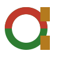

# aloop brand

Every file here is generated by [`gen_brand.py`](gen_brand.py) from one palette and one mark
geometry, so a change is one edit and one run:

```bash
pip install 'fonttools[woff]' uharfbuzz cairosvg   # once
# also needs the cairo library (brew install cairo / apt install libcairo2) and npm,
# which fetches the fonts (@fontsource, SIL OFL)
python3 docs/brand/gen_brand.py
```

All text in the assets is outlined, so nothing depends on an installed font.

## The mark



A geometric lowercase **a**, for aloop and Aladdin. Its bowl is **the loop**: a ring that is
**red** on top (the failing proof) and **green** below (earned). Its stem is **the gate**: two
gold posts that the ring passes between. The loop goes into the gate red and comes out green.
*Models explore. Gates decide.*

**Construction (24 grid).** Ring centre (11, 12), centreline radius 7.5, stroke 3. Posts
x 17–21, y 3–9 and y 15–21, one unit proud of the ring, so the gate still shows as a notch in
one colour. Paint the whole ring green, then the red top half, then the posts, so a seam can
only ever show green. **16 px cut:** ring centre (7, 8), radius 5, stroke 2, posts x 11–14,
y 2–6 and y 10–14, all on whole pixels. Use the 16 px cut from 16 to 20 px and the 24 master
from 24 px up.

**Why this mark.** Three directions were drawn, rendered at 16, 32 and 96 px on both grounds,
and judged:

| Direction | Verdict |
|---|---|
| A lamp whose ring handle is the loop, with a red-to-green flame | At 16 px the body is a blob and the flame a two-pixel fleck. At 96 px, next to the name Aladdin, it reads as a "magic lamp". |
| An **a** with a red-to-green flame inside the bowl | The flame turns into a muddy blob at 16 to 32 px, and the one-colour version is noise. |
| **An a whose bowl is a loop that passes a gate** (chosen) | The only one that reads at 16 px on both grounds. Three shapes, and it carries the loop, RED to GREEN and the gate. |

The illustrated lamp stays the hero art of the site (`docs/index.html`).

**Clear space** is one post width (4 units on the 24 grid) on every side. **Minimum size** is
16 px, using the 16 px cut.

**Don't:** redraw the ring in one colour while keeping the posts gold (red and green are the
meaning); put the mark on a red or green ground; add an arrowhead to the ring (it turns into a
refresh icon).

## Colour

One accent, gold, which only the gate (and accent text) carries. Red and green appear only in the
RED→GREEN meaning. Ratios are WCAG against `bg`; `check_palette()` checks every text token, red and
green included, at 4.5:1 on both `bg` and `panel` on every run.

| Token | Dark | Light | Use |
|---|---|---|---|
| `bg` | `#0f1117` | `#faf8f2` | page ground |
| `panel` | `#171a23` | `#ffffff` | cards, terminal panels |
| `ink` | `#e8e6df` (15.1:1) | `#1d1d1b` | body text, the wordmark |
| `muted` | `#9a9890` (6.5:1) | `#5f5e58` (6.1:1) | secondary text |
| `gold` | `#d9a441` (8.4:1) | `#b47a1e` (3.4:1) | the mark's gate; graphics only on light grounds |
| `gold-text` | `#d9a441` | `#8a5a12` (5.6:1) | accent text |
| `red` | `#dc5a56` (5.1:1) | `#c0392b` (5.1:1) | RED: the failing proof; also label text, so 4.5:1 on `bg` and `panel` |
| `green` | `#5cb85c` (7.6:1) | `#2e7d32` (4.8:1) | GREEN: earned |

Red and green are told apart by hue only; where that matters (charts, status), pair them with a
word or a shape (✕ and ✓), as the banner does.

## Type

- **Wordmark and headings:** Space Grotesk Bold, lowercase `aloop`, tracking −0.02 em.
- **Code, labels, the terminal:** JetBrains Mono (Medium for text, Bold for labels).

## Files

| File | Where it goes |
|---|---|
| `banner-light.png`, `banner-dark.png` (+ `.svg`) | the README header, through a `<picture>` that follows the GitHub theme |
| `social-preview.png` (1280×640) | GitHub → Settings → General → Social preview (PNG, JPG or GIF under 1 MB; not SVG) |
| `og-card.png` (1200×630) | the site's `og:image` and `twitter:image` |
| `favicon.svg` (the 16 px cut; follows the colour scheme), `favicon-16.png`, `favicon-32.png` | the site's `<link rel="icon">` |
| `app-icon-180.png`, `app-icon-512.png` | `apple-touch-icon`, avatars, marketplace listings |
| `mark-light.svg`, `mark-dark.svg`, `mark.svg` (adaptive), `mark-16.svg`, `mark-mono.svg` | the mark alone; `mark-mono.svg` uses `currentColor` |
| `lockup-light.svg`, `lockup-dark.svg` | the mark beside the wordmark |

README header snippet:

```html
<picture>
  <source media="(prefers-color-scheme: dark)" srcset="docs/brand/banner-dark.png">
  
</picture>
```

## Voice

Plain and specific. Lead with what happens and the number that proves it ("13/13 checks, 9m54s,
$0.70"), never with adjectives. The product name is lowercase **aloop**; **Aladdin** is the 1.0
product and the `aladdin` command. No genie, carpet or lamp-rubbing imagery: the lamp in the
site art is an original drawing, and the mark is a letter, a loop and a gate.
